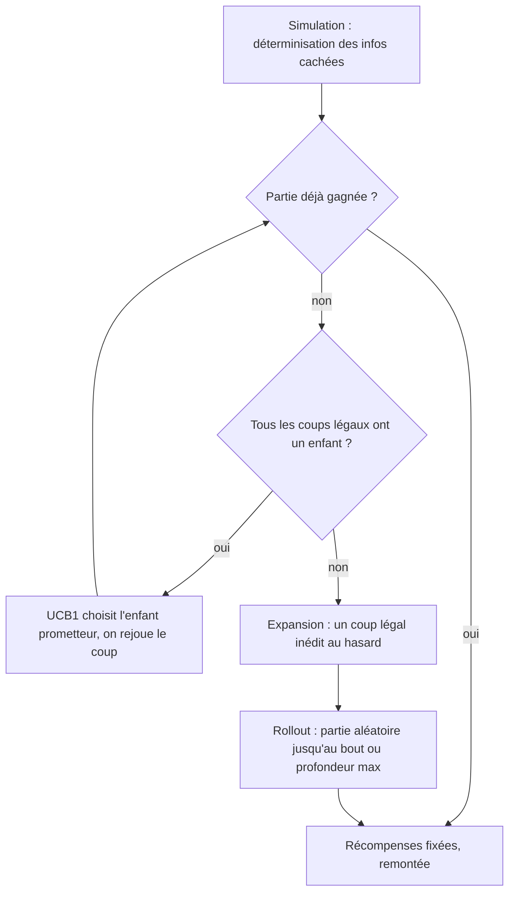

# ADR 0003 : ISMCTS pour le joueur de recherche

- Statut : accepté
- Date : 2026-11-02

## Contexte

Le MCTS classique construit un arbre d'états. Au Rummikub, la main des
adversaires et le contenu de la pioche sont cachés : un arbre bâti sur l'état
réel « verrait » ce que le joueur ne peut pas voir, et produirait des plans
conditionnés à une information interdite (*strategy fusion*).

Les alternatives écartées pour l'instant : le RL (PPO — coûteux à mener à
bien, à explorer plus tard), et un MCTS naïf sur l'état réel.

## Décision

ISMCTS (Information Set MCTS, Cowling et al. 2012) :

1. **Déterminisation** — chaque simulation part d'un tirage cohérent des
   informations cachées : les tuiles inconnues (tout sauf notre main et le
   plateau) sont mélangées, chaque adversaire reçoit autant de tuiles que sa
   main en contient vraiment, le reste devient la pioche.
2. **Arbre partagé** — les statistiques s'accumulent dans un arbre unique
   indexé par la séquence de coups (pas par l'état exact).
3. **Coup::Terminer** — la recherche doit pouvoir choisir de finir son tour,
   d'où l'ajout dans le core.

Les coups légaux viennent exclusivement de `coups_possibles`, l'application
exclusivement de `jouer_coup` : la recherche ne peut pas tricher.

## Une simulation en un coup d'œil

## Réglages retenus (2026-11-02)

- **Rollouts ε-greedy** : pendant un rollout, jouer le coup heuristique (la
  meilleure pose, sinon piocher) avec probabilité 1−ε, un coup au hasard avec
  probabilité ε. ε par défaut : 0.2. Le banc d'essai (tournoi à graines)
  permet de mesurer le meilleur ε.
- **Récompenses officielles** : en fin de partie, le gagnant marque 1 (la
  victoire) plus la valeur des mains adverses ; chaque perdant perd la valeur
  de sa propre main. Le joker resté en main vaut 30 points. Le tout
  normalisé (/100) pour rester comparable à la prime de victoire.
- **Parallélisation à la racine** (rayon) : les simulations sont réparties
  entre des arbres par thread — graine dérivée par thread — puis fusionnés
  en fin de recherche. La décision est reproductible à nombre de threads
  fixé (`threads: 1` dans les tests).

## Pistes d'amélioration (en attente de décision)

- **Élargissement progressif** : le facteur de branchement est énorme
  (centaines de coups légaux par nœud) et l'arbre s'éparpille — la plupart
  des enfants ne sont visités qu'une ou deux fois. Limiter le nombre
  d'enfants développés par nœud selon les visites du parent (formule
  classique k = α × N^β), en commençant par les coups les mieux triés —
  ou plus simplement, ne développer que les coups au-dessus d'un seuil de
  points. Risque : couper un coup génique peu évident ; le seuil se règle
  avec le tournoi.
- **Récompenses pour les rollouts non terminés** : estimer l'avantage
  courant au lieu de tout mettre à 0 — attention au reward shaping mal
  calibré.

## Constats du flamegraph (2026-11-02)

Profilage release d'un tournoi 5 graines × 50 simulations :

- L'**allocation mémoire** domine (malloc/realloc/free ≈ 5% cumulés) : les
  `Vec<Combinaison>` clonés pour chaque coup énuméré et chaque état de
  manipulation sont la cible principale d'une future optimisation.
- Le **hachage des identifiants de tuiles** (`HashSet<u8>` dans
  `verifier_proposition`, `soumettre_plateau`, `plateau.ids_tuiles`,
  `poses_initiales`) coûte ≈ 2-3% — remplaçable par des bitsets (106 tuiles
  = 2 × u64) si besoin de vitesse.
- La **surcharge rayon** (sched_yield, réveils de threads) est visible à
  petit nombre de simulations : à 50 par décision, envisager moins de
  threads ou plus de simulations par thread.
- `combinaisons_possibles` elle-même n'est PAS le goulot d'étranglement :
  c'est ce qui l'entoure (allocations + hachage) qui coûte.
